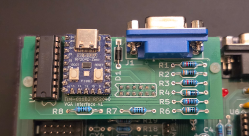

# T2.1-VGA-RP2040

VGA Adapter for TIM-011B2 v2.1 using the RP2040 Mini. Code based on RGBI_TO_VGA by Dmitry Tsvetkov can be found on [Marko's fork for the TIM011B2](https://github.com/msolajic/RGBI_TO_VGA).

## Versions

v1 Initial version
