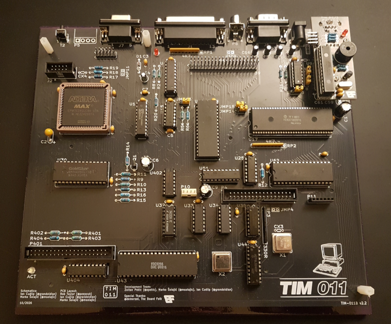

# TIM-011B Version 2

A new updated remake of the TIM-011 computer from Serbia.

This repository contains the Bill-of-Materials (BOM), Gerbers and Kicad files for the new colour-capable, updated remake of the TIM-011 from the Mihajlo Pupin Institute of Serbia, 1987.

The original TIM-011 is a CP/M based computer that uses the Z80 family Hitachi HD64180 processor with 256KB RAM, 4 scale monochrome video and a FDC9266 floppy disk controller on the main board. It has an expansion bus, serial and parallel port and an ASCII keyboard interface. 

This is an adaptation of the board found at the original [TIM-011B](https://github.com/Board-Folk/TIM011B) remake repository.

In addition to the changes made to revision 1 of the project, the updated version 2 board replaces most of the video circuitry an Altera EPM7128 - CPLD logic by Marko Šolajić, including a new colour video mode. The addressing logic has also been simplified with a ATF16V8B, GAL type chip. The 8 bit IDE expansion has been added on the main board to allow the connection of a Compact Flash adapter for hard disk like use. The ROM size has been extended to allow for the use of 39SF040 also, to increase the purpose of the board with the wider range of boot ROMs and Operating Systems now available. The RAM has been changed to the now more easily available AS6C4008 and compatible SRAM.

The system can still be built entirely from off-the-shelf parts commonly available on reseller sites as no custom-made chips are used.

As of version 2.2 the overall board layout is the same as the original, but does not have the ability to drive the original CRT and doesn't provide the original Ei Niš power connector so cannot be practically used in an original case without modification.

Please see the 8bitchip [blog](https://blog.8bitchip.info/582-tim-011-v2-2-whats-new/) for more information on the version 2 update to the board. 

Projects are in Kicad 9.

## Building the board

The Kicad iBOM plugin has been used to create an interactive BOM in the BOM subfolder for the main board and expansion boards. Since these builds use obsolete parts, such as the CPU, FDC and RAM, we cannot provide any links to those parts. They are available on AliExpress and eBay, but many sellers will ship relabeled or faulty ICs. Be careful.

The Altera EPM7128 can be programmed using the JTAG header at location J2 using a USB Blaster or similar programmer with software downloadable from the Altera website. Please see Marko's Readme in the CPLD folder.

## Using the board

### Power

A 4 pin 3.96mm right angle header for 5V and 12V power where 12V is required (for an original keyboard or older model floppy drive). A centre positive DC barrel jack for 5V only operation is included also.

### Video

Three video output options are available on the version 2 board, including standard composite video output on an RCA/phono jack. 

RGBi is provided on a 9 pin female D-Sub connector and a new expansion header with RGBtoHDMI compatible pinout has been included for modules. A RP2040 based module for VGA is in the Expansion folder.

#### J7 RGBi

|Pin|Description|Notes|
|:--:|:--:|:--:|
|1|Ground||
|2|Ground||
|3|Red||
|4|Green||
|5|Blue||
|6|Intensity||
|7|Composite/CSync|JMP16|
|8|Horizontal Sync||
|9|Vertical Sync||

#### P9 RGBtoHDMI / Module

|Pin|Description|Notes|
|:--:|:--:|:--:|
|3|Ground||
|4|Intensity||
|6|Clock / N/C|JMP17|
|7|Red||
|8|Horizontal Sync||
|9|Green||
|10|Vertical Sync||
|11|Blue||
|12|+5V||

### Keyboard

The original keyboard is serial ASCII, 9600 8E1 with a 12V power output on the 5 pin DIN header. Alternative PS/2 adapters are available from the original project including a mini overlay board in the [Extensions](https://github.com/Board-Folk/TIM011B/tree/main/Extensions) folder. This has not changed from the v1.3 board layout system. There is no way of powering an original TIM-011 12V keyboard from a 5V only power source to the board.

### Sound

The sound and joystick expansion module is available in the [TIMAYSound](https://github.com/Board-Folk/TIM011B/tree/main/Extensions/TIMAYSound) folder of the original project.

### Operating System

No operating system is included within the standard TIM-011 ROM - it needs to boot this from floppy disk or equivalent Gotek/Flash Floppy or Compact Flash device. Alternative ROMs will provide different functionality.

With the larger capacity of the new ROM and jumper selection, a ROM image for multi-boot system can be made.

A TIM-011 boot ROM image can be found in the rom folder. Similarly, a sample CF card image in the cf folder and boot floppy in the floppy folder. See Marko Šolajić's [website](https://blog.8bitchip.info/tim011-resources/) for updates and more information.

## TIM011 Resources

See [TIM011 Resources](https://github.com/Board-Folk/TIM011B#tim011-resources) for links to resources from the original project.

## Revisions

* Version 2.2 Initial Public Release
  
### Version 2.1

* Dual 27512 / 39SF040 ROM size
* AS6C4008 SRAM
* Altera EPM7128 video logic
* ATF16V8B address logic
* Compact Flash Adapter header on board
* RGBtoHDMI / video expansion

### Version 2.2

* Changed all IDC to boxed headers
* Add Floppy Power Header
* Add MicroSD card header for RomWBW
* Changed Video RAM to dual footprint
* Cosmetic Adjustments

## Jumper Settings

Version 2.2

|Jumper|Description|Default|
|:--:|:--:|:--:|
|JMP1|CTS0 Select|2-3|
|JMP2|CTS/DCD Select|4-5,7-8|
|JMP4|FDC Ready|Optional|
|JMP5|Keyboard Power|1-2 D 12V, 2-3 U 5V|
|JMP9|12V Expansion Pin 40|NF|
|JMP11|Invert Sync|Off Invert, On Normal|
|JMP13|ROM A18|1-2 5V, 2-3 GND - BANK|
|JMP14|ROM A17|1-2 L 5V, 2-3 R A17|
|JMP15|ROM Write|1-2 5V, 2-3 /WR|
|JMP16|RGBI Pin 7|1 - Composite, 3 - CSYNC|
|JMP17|Clock for RGBtoHDMI Header|On/Off|

## Links

   [Marko's Blog Post on the TIM 011](https://blog.8bitchip.info/482-tim-011-a-new-life-for-an-old-computer/)

## Credits

PCB Layout by Rob Taylor @peepouk, Ian Cudlip @grandoldian and Marko Šolajić @msolajic. Schematics recreated and modifications by Ian Cudlip and Marko Šolajić. Logic by Marko Šolajić. Special thanks to @demerzel.

## Thanks

* Zoltan Pekic
* @demerzel
* The Board Folk Team

## Legal

As the product of this project is a replica of a proprietary product, the the author makes no claim of copyright to the schematics nor PCB layouts and releases these into the public domain, solely for the purposes of study and historical preservation.

You are free to produce PCBs based on this project's designs at your own risk and without limitation, for your own use or for sale and/or repair at a reasonable price. Attribution is appreciated. The authors are not obliged to provide support of any kind. 

Under no circumstances will the authors be held responsible or liable in any way for losses, damages or costs resulting from the use of the information and/or resources of this project. 

The resources are provided "as-is" without warranty of any kind, either expressed or implied, including, but not limited to, the implied warranties of merchantability and fitness for a particular purpose.
