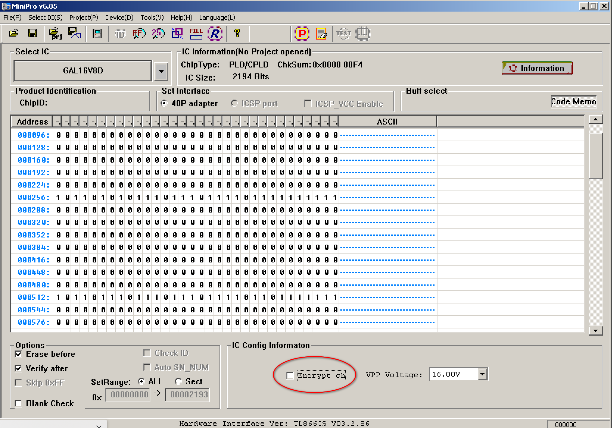

This code is for the Address decoder that is implemented in GAL. This enables us to remove some 4-5 TTL ICs from the board, maintaining full compatibility with the original address decoding scheme. Please use the GAL code written speciffically for the board you are building.

In addition to the address decoder, an additional latch which is activated by writing to address 0xC8 and reset by writing to address 0xCC has been added, to be used as MicroSD Card /CS for future RomWBW support. This is in the area of the printer port, but it never writes to these addresses, only to 0xC0 and 0xC1 so it does not interfere with the regular workings of the computer.

I/O Address ranges decoded by the GAL are:

- /FDCSEL: 0x80-0x9F
- /FDCDMA: 0xA0-0xBF
- /PRINT: 0xC0-0xC7
- /LATCH: 0xC8-0xCF
- /EXPSEL: 0xE0-0xE7, 0xF0-0xFF
- /IDECS: 0xE8-OxEF

I/O Address range 0xD0-0xDF is decoded by the CPLD.

`                            Chip diagram (DIP)

                             ._____    _____.
                             |     \__/     |
                             |  1        20 | VCC
                         A15 |  2        19 | /LATCH
                          A7 |  3        18 | 
                          A6 |  4        17 | 
                          A5 |  5        16 | /IDECS
                          A4 |  6        15 | /PRINT
                         IOE |  7        14 | /EXPSEL
                          A3 |  8        13 | /FDCDMA
                          A2 |  9        12 | /FDCSEL
                         GND | 10        11 | 
                             |______________|`

Note: Several GALs have been found to function incorrectly if the "Encrypt Ch" option in the TL866 (and similar) programmer software is used. Please disable the "Encrypt Ch" option before programming the GAL.

